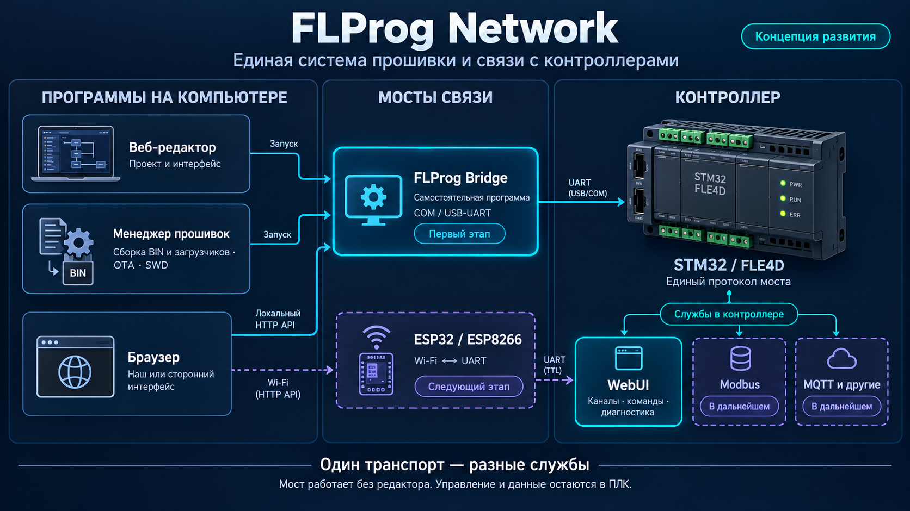

# Архитектура мостов FLProg Network

Схема отражает направление развития, а не перечень уже испытанных возможностей.
Условный рисунок ПЛК не является фотографией конкретной модели FLE4D.
Стрелка UART от ESP заканчивается в области служб контроллера: физически ESP
соединяется с UART STM32, который направляет кадры нужной службе.

1. Редактор создаёт интерфейс. Менеджер собирает приложения/загрузчики и прошивает.
2. Обе программы могут запустить самостоятельный мост, не управляя его жизнью.
3. PC-мост принимает HTTP от браузера и передаёт ограниченные кадры через COM.
4. Будущий ESP-мост предоставляет тот же API через Wi-Fi и общий UART-протокол.
5. Контроллер остаётся владельцем значений каналов и исполнительной логики.
6. WebUI, Modbus и MQTT — отдельные службы; устройство объявляет только реализованные.

В первой версии прототипа: сервисная WebUI-страница и typed-channel API.
Для полного макета редактора понадобится экспорт статических ресурсов и адаптер
страниц/групп/описаний. Перед загрузкой проверяются ID проекта; хеш-манифест и
автоматический кеш ресурсов ещё планируются. Не обещать совместимость чужого
сайта без поддержки нашего публичного API.

Modbus: решить, мост ретранслирует запросы TCP↔RTU или обращается к таблице
регистров ПЛК; нужны transaction ID, unit ID, таймауты и исключения.
MQTT: решить, MQTT-клиент находится на PC/ESP либо передаётся поток клиента ПЛК;
нужны подписки, QoS, backpressure и политика потери связи. Номер службы сам по
себе этого не реализует. Нагрузка каждого адаптера должна быть ограничена,
чтобы WebUI и цикл ПЛК не зависели от долгого обмена другой службы.

Возможность прошивки через тот же мост оценивается отдельно: адреса/области
Flash, проверка образа, совместимость и неприкосновенность загрузчика обязательны.
